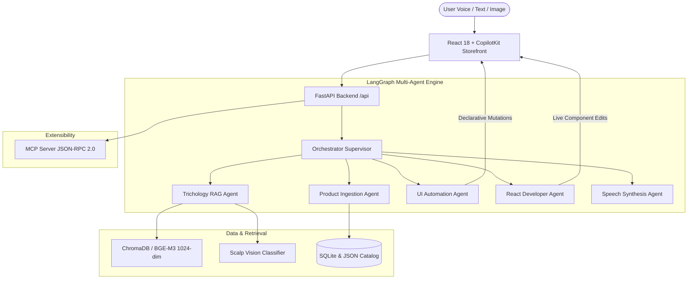

# 🌿 FolliCare AI - Multimodal Trichology AI Assistant & E-Commerce Platform

[](https://www.python.org/)
[](https://reactjs.org/)
[](https://vitejs.dev/)
[](https://fastapi.tiangolo.com/)
[](https://github.com/langchain-ai/langgraph)
[](https://www.trychroma.com/)
[](https://modelcontextprotocol.io/)

> **FolliCare AI** is a state-of-the-art clinical trichology and botanical hair cosmetics platform. It couples a responsive **React 18 + CopilotKit** luxury storefront with a **LangGraph Multi-Agent** backend, **ChromaDB dense semantic vector search (BGE-M3 embeddings)**, **real-time voice STT/TTS**, **multimodal scalp analysis**, and a **Model Context Protocol (MCP)** server.

---

## 🌟 Key Capabilities & Features

### 1. 🛍️ Luxury Botanical E-Commerce Storefront (React 18 & Vite)
- **Clinical Trichology Formulas:** Categorized for targeted concerns (*Hair Fall & Thinning*, *Damaged & Bleached Strands*, *Dandruff & Flake Control*, *Curls & Coils 3A-4C*, *Thermal Heat Shield*, and *Color & Tone Glaze*).
- **Curated Beauty Aesthetic Themes:** 5 switchable real-time themes (`🌿 Botanical Emerald`, `🌸 Rose Luxury`, `💜 Lavender Clean`, `🌙 Amber Noir`, and `☀️ Light Minimal`).
- **Interactive Cart & Regimen Drawer:** Dynamic cart drawer with promo codes, free shipping thresholds, and 1-click bundle routine builder.
- **CopilotKit AI Copilot:** Embedded AI copilot popup with real-time UI action execution (`SET_THEME`, `FILTER_PRODUCTS`, `SCALE_CARDS`, `UPDATE_PRICE`, `ADD_TO_CART`).

### 2. ⚡ LangGraph Multi-Agent System
- **🎯 Supervisor Orchestrator Agent (`agents/orchestrator.py` & `agents/langgraph_workflow.py`):** StateGraph workflow handling query intent classification, memory routing, and validation loops.
- **📚 Trichology RAG Agent (`agents/rag_agent.py`):** Dense semantic retrieval over clinical ingredient trials, contraindications, and treatment protocols with citation scoring.
- **📦 Voice & Text Product Ingestion Agent (`agents/product_agent.py`):** Parses unformatted audio/text input (e.g., *"Add Rosemary Scalp Oil with 3% Biotin for $28"*), extracts entities, persists to SQLite, and updates vector indices on the fly.
- **🎨 Declarative UI Automation Agent (`agents/ui_agent.py`):** Translates user intent into declarative UI mutations dispatched to the browser DOM.
- **🎙️ Voice Dialogue & Speech Synthesis (`agents/response_agent.py`):** Speech-to-text (STT) and Web Speech API text-to-speech (TTS) synthesis.
- **💻 Autonomous React Developer Agent (`agents/react_coder_agent.py`):** Real-time code inspect and repair engine with AST-level safety for the React developer panel.

### 3. 🔍 Dense Vector RAG & ChromaDB Integration
- **BGE-M3 Dense Embeddings (`rag/chroma_vector_store.py`):** 1024-dimensional normalized dense float embeddings via local Ollama `bge-m3` with ultra-fast MD5-hashed fallback.
- **Multimodal Scalp Diagnostics (`rag/multimodal_rag.py`):** Scalp image inspection and clinical classification (Seborrheic dermatitis, Traction alopecia, Telogen effluvium, Folliculitis).
- **In-Memory & Persistent Vector Store:** Zero cloud lock-in with persistent local vector storage.

### 4. 🔌 Model Context Protocol (MCP) Server (`mcp_server.py`)
- Compliant with Anthropic's **Model Context Protocol (JSON-RPC 2.0)** over stdio and HTTP (`/api/mcp/rpc`).
- Exposes tools: `search_hair_knowledge`, `get_catalog_products`, `ingest_new_product`, `execute_ui_mutation`, `recommend_hair_routine`.
- Exposes resources: `follicare://catalog`, `follicare://knowledge-base`, `follicare://system-info`.

---

## 🏛️ System Architecture



---

## 🚀 Getting Started

### Prerequisites
- **Python 3.10+**
- **Node.js 18+** & npm
- *(Optional)* [Ollama](https://ollama.ai/) with `bge-m3` or `llama3` for local LLM/embedding inference.

### 1. Clone the Repository
```bash
git clone https://github.com/kalyanemani/follicare-ai.git
cd follicare-ai
```

### 2. Backend Setup
```bash
# Create and activate a virtual environment
python -m venv venv
# Windows:
venv\Scripts\activate
# Linux/macOS:
source venv/bin/activate

# Install dependencies
pip install -r requirements.txt
```

### 3. Frontend Setup
```bash
cd react_app
npm install
cd ..
```

---

## 🏃 Running the Application

### Option A: Run Full Stack (Backend + React Frontend)

**Terminal 1 — FastAPI Backend:**
```bash
python app.py
```
*API running at:* `http://127.0.0.1:8000`

**Terminal 2 — React Storefront:**
```bash
cd react_app
npm run dev
```
*Storefront running at:* `http://127.0.0.1:5173`

---

### Option B: Run Streamlit Interactive Dashboard
```bash
streamlit run streamlit_app.py
```
*Dashboard running at:* `http://localhost:8501`

---

### Option C: Run via Docker
```bash
docker-compose up --build
```

---

## 🧪 Running Automated Tests

Run the comprehensive multi-agent, RAG, and MCP test suite:
```bash
python -m pytest tests/
# Or direct runner:
python tests/test_agents.py
```

---

## 🔌 Connecting to Claude Desktop / Antigravity IDE (MCP)

To connect this application's Model Context Protocol (MCP) server to **Claude Desktop** or **Antigravity IDE**, add this configuration to your `claude_desktop_config.json`:

```json
{
  "mcpServers": {
    "follicare-cosmetics": {
      "command": "python",
      "args": ["<PATH_TO_REPO>/mcp_server.py"]
    }
  }
}
```

---

## 📁 Repository Structure

```
.
├── FolliCare_AI_Architecture_Specification.pdf  # Formal Architecture Spec Document
├── README.md                                   # Project Documentation
├── app.py                                      # FastAPI Application Server & REST Endpoints
├── mcp_server.py                               # Model Context Protocol (MCP 2.0) Server
├── metrics_dashboard.py                        # Observability & Metrics Dashboard
├── streamlit_app.py                            # Streamlit Interactive Agent Dashboard
├── requirements.txt                            # Python Dependencies
├── Dockerfile                                  # Backend Container Definition
├── docker-compose.yml                          # Full Stack Docker Compose Setup
├── agents/                                     # LangGraph Multi-Agent Graph & Agents
│   ├── orchestrator.py                         # Supervisor Orchestrator Agent
│   ├── langgraph_workflow.py                   # LangGraph StateGraph Execution Pipeline
│   ├── product_agent.py                        # Voice & Text Product Ingestion Agent
│   ├── rag_agent.py                            # Trichology Clinical RAG Agent
│   ├── ui_agent.py                             # Declarative UI Automation Agent
│   ├── react_coder_agent.py                    # Autonomous React Developer Agent
│   ├── response_agent.py                       # Voice Dialogue & Speech Synthesis Agent
│   ├── memory.py                               # Hindsight Memory Engine
│   └── monitoring.py                           # Trace Observability & Metrics
├── rag/                                        # Retrieval-Augmented Generation
│   ├── chroma_vector_store.py                  # ChromaDB Vector Store with BGE-M3 Embeddings
│   ├── multimodal_rag.py                       # Scalp Image Vision Classifier & RAG
│   ├── chunker.py                              # Semantic & Recursive Text Chunker
│   ├── vector_store.py                         # In-Memory Fast Fallback Vector Store
│   └── knowledge_base.json                     # Clinical Trichology Knowledge Base
├── react_app/                                  # React 18 + CopilotKit Luxury Frontend
│   ├── src/
│   │   ├── components/                         # Storefront Components & Panels
│   │   ├── hooks/                              # useFolliCare State & UI Hooks
│   │   └── App.jsx                             # Main Application Entrypoint
│   ├── package.json                            # Vite & React Dependencies
│   └── vite.config.js                          # Vite Configuration
├── data/                                       # Catalog & Database
│   ├── products.json                           # Active Botanical Product Catalog
│   └── follicare.db                            # SQLite Relational Database
├── static/                                     # Classic Vanilla JS/CSS Storefront (Fallback)
└── tests/                                      # Automated Pytest Suite
```

---

## 📄 License
This project is licensed under the MIT License.
